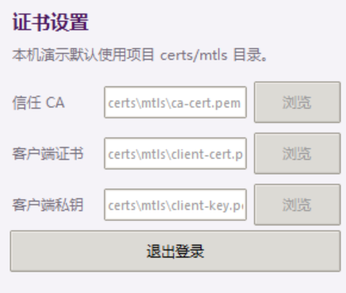
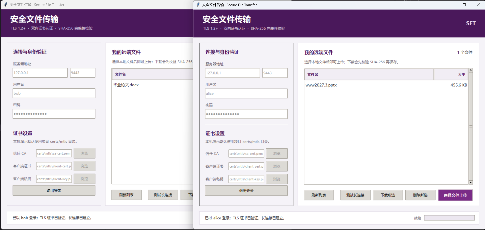

# 《软件与系统安全》实验报告：安全文件传输系统设计与实现

学生姓名：王以恒　学号：202628013229016　Git 仓库：https://github.com/add0010/HW1/tree/main/1B_secure_file_transfer  
实验环境：Windows 11 操作平台，Python 3.12 运行环境，PowerShell 7 脚本环境  

---

## 1 任务背景与方案选型

本实验要求实现具备机密性、完整性保障以及身份鉴别能力的安全文件传输系统。

在实验选型上，实验 1A 侧重底层数据包捕获与网络协议解析，但在 Windows 平台下严重依赖 Npcap 或 WinPcap 等第三方驱动组件。当处于多网卡绑定、无线网络混杂模式或者特定驱动版本时，容易引发底层捕获异常与动态链接库调用错误。实验 1B 则聚焦于安全应用层协议的设计与实现，利用 Python 运行时原生提供的套接字、传输层安全协议库以及散列函数模块，便可以在操作系统标准网络接口之上构建完整的安全通信协议栈。因此本项目选择实验 1B。

本项目的实现目标包含带图形界面的客户端、命令行管理终端以及具备多连接并发处理能力的服务端。传输过程全面启用双向传输层安全认证与账号散列鉴别，提供针对网络攻击的安全防护手段，包括防暴力破解限速、路径穿越过滤、用户沙盒隔离以及端到端文件哈希一致性校验。

---

## 2 系统架构与模块职责划分

系统在架构设计上划分为表现层、协议处理层、安全通信层以及服务端业务存储层，各模块通过严格定义的接口实现解耦。

客户端表现层包含基于图形界面的脚本 `client_gui.py` 与基于命令行的脚本 `client.py`。图形客户端基于 Tkinter 构建，提供用户凭据输入、证书路径指定、远端文件检索浏览、文件上传下载交互以及底层长连接保活状态的展示。为了防止文件分块传输引发图形界面主事件循环假死，表现层通过启动后台守护工作线程来承担所有的网络输入输出，并通过消息队列向主线程派发进度更新事件。

协议处理层封装在 `protocol.py` 中，作为系统的通用中间件。该模块负责处理底层流式套接字存在的无边界问题，实现应用层控制报文的分帧编码与解码，并提供基于大端序前缀的定长读取函数。此外，协议模块内嵌了针对二进制数据流的实时摘要生成逻辑，在传输过程中同步推进散列计算。

安全通信层依托 Python 标准库的 ssl 模块，在原始 TCP 套接字之上建立加密隧道。服务端强制启用对客户端证书的合法性核验，客户端也同步验证服务端凭据与本地颁发机构信任链，确保通信双端身份真实有效。

服务端核心层由 `server.py` 实现，负责接入客户端套接字并分派至工作线程池。服务端内嵌了速率控制模块、基于 JSON 文件的用户凭据安全存储机制、单用户配额校验器以及文件存储目录隔离机制，负责全生命周期的会话维持与异常清理。

---

## 3 自定义安全传输协议设计

### 3.1 混合分帧结构与粘包处理机制
底层传输控制协议提供的是无边界的连续字节流，应用层必须自行界定每条业务消息的起始与终止点。本系统设计了定长前缀结合 JSON 控制报文及裸二进制载荷的混合分帧机制。

整个数据帧的起始部分为固定 4 字节的长度字段，采用网络字节序也就是大端序编码的无符号整型数据。该长度数值精确指出其后紧随的 JSON 控制头的字节总数。系统在协议层设置了控制头长度的硬性约束，规定其大小必须在 1 字节至 65535 字节之间。若接收端解析出的前缀越界，则视为遭受恶意畸形报文探测并直接切断套接字，防止攻击者利用超大前缀诱发服务器内存溢出。

紧随长度字段的是 UTF-8 编码的 JSON 格式控制头，用于在双端同步操作指令、状态码与元数据。当控制头中的文件尺寸字段大于零时，紧邻 JSON 控制头之后会直接传送完全等于该尺寸的二进制文件载荷。文件实体数据不经过 Base64 等编码转换，直接以裸字节流输出，规避了额外的内存拷贝与数据膨胀开销。

在底层数据接收环节，双端严禁对单次套接字接收函数的返回值长度做理想化假设，必须循环调用底层接收接口，直到实际累加获取的字节数与目标期望长度完全相等，或者捕获到连接断开标志，从而在代码层面彻底根除 TCP 粘包与半包异常。

### 3.2 交互指令体系与协议状态转换
通信双方的交互流程受状态机严格约束。整个连接周期由未认证状态、认证就绪状态以及文件传输就绪状态组成。

未认证状态下，套接字通道仅允许传输认证指令。客户端必须提交用户名及明文口令进行身份换取。若校验失败，服务端记录惩罚计数并返回通用失败响应；若校验成功，连接跃迁至已认证就绪状态。

在认证就绪状态下，客户端可复用该长连接连续发起元数据操作。执行列表指令时，服务端遍历该用户专属目录，将文件名、字节数以及分页游标打包回传。执行测试指令时，客户端发送保活探针，服务端响应对应报文，双端维持链路存活。

当发起文件上传时，客户端先提交包含文件名、文件体积与预计算 SHA-256 摘要的上传请求。服务端校验文件名合规性与剩余存储配额，确认允许后返回就绪响应。随后连接进入文件传输就绪状态，客户端按分块推流发送精确字节数，服务端写入同级临时缓存并校验摘要，校验通过后完成原子落盘并回归认证就绪状态。

下载流程同样遵循此逻辑，服务端先行返回目标文件的大小和安全摘要，客户端确认磁盘空间后接收数据流，流式校验完成并在本地执行最终落地。

---

## 4 核心安全机制实现细节

### 4.1 双向传输层安全认证与通信机密性
为防止局域网 ARP 欺骗与中间人监听，系统通信链路全面依托双向 TLS 机制建立。

在服务端初始化阶段，配置上下文加载服务器私钥与服务器证书，并将验证模式显式指定为强制要求客户端证书。服务端导入专用演示 CA 根证书，凡是无法提供由该 CA 签发之合法证书的访问请求，均会在底层握手阶段被传输层拦截并阻断。

在客户端初始化阶段，系统同样指定信任的根 CA 证书以校验服务端真实性，同时加载本地分配的客户端数字证书与私钥文件。只有在双方密码学证书均通过交叉核验且算法套件协商一致后，应用层控制通信才正式开始。

### 4.2 认证凭据安全存储与暴力破解防护
用户鉴别体系采用加盐散列技术。用户信息持久化保存在服务端的 `users.json` 文件中，禁止记录任何明文口令。

当管理员添加新用户时，系统借助操作系统的密码学安全随机源生成 32 字节长度的随机盐值，并利用基于 SHA-256 的密码散列算法 PBKDF2 执行 100000 次密钥衍生迭代运算。用户验证时，服务端调取对应盐值执行同等运算，并将结果与预存散列值送入恒定时间比较函数 `compare_digest` 校验，彻底阻断利用字符串匹配微小耗时差异发起的侧信道时序攻击。

针对接口扫描与暴力破解，服务端在运行内存中维护基于来源网络地址的失败滑动窗口。若某一客户端地址在 60 秒内累计遭遇 5 次认证失败，系统将强制锁定该地址的接入权限 5 分钟。同时系统实施认证反馈模糊化策略，无论是账号不存在还是密码不匹配，均返回完全一致的通用报错，杜绝账号枚举风险。

### 4.3 存储沙盒隔离与跨目录攻击拦截
服务端针对每个注册账号开辟独立的物理存储路径，格式为 `storage/<用户名>/`。为防止恶意客户端构造诸如含有父级目录特征或者空字节截断的特殊文件名发起目录遍历攻击，系统实施了三重防御闭环。

第一重采用正则表达式白名单策略，强制限定文件名仅可包含英文大小写字母、数字、下划线、减号以及点号。

第二重针对 Windows 平台特性，显式屏蔽包含 CON、PRN、AUX、NUL 等底层系统保留设备标识符的命名请求，防止底层文件句柄陷入死锁。

第三重实施物理路径收敛核验。在拼接目标文件路径后，服务端调用系统物理路径规范化函数取得绝对路径，核验该路径的前缀文本是否完全包含用户根存储沙盒路径。一旦发现目标超出了用户沙盒的物理边界，系统立刻抛出安全违规异常并记录审计日志。

### 4.4 临时缓存写入与原子替换操作
在网络文件传输过程中，断网、传输畸变以及恶意数据篡改均会导致磁盘残留受损文件，若直接写入目标路径还会造成原文件的不可逆破坏。系统设计了端到端校验与原子替换机制。

服务端或客户端在接收二进制流时，首先在目标同级目录下建立带有随机临时标记的隐藏文件。文件数据边接收边写入磁盘，内存中的摘要计算对象同步进行分块迭代。数据接收完毕后，系统将计算所得哈希值与对端预先声明的 SHA-256 进行比对。

只有在字节长度完全吻合且哈希摘要完全一致的情况下，系统才调用底层的原子替换系统调用，瞬间将临时文件重命名为正式目标文件；若校验出现丝毫偏差，系统立刻执行删除操作抹除临时文件，保障用户目录下的有效资产始终处于高可用与高一致性状态。

---

## 5 客户端多线程并发与交互设计

图形客户端基于 Python 内置的 Tkinter 框架构建，在保证界面运行效率的同时去除了第三方外部库的编译依赖。

由于图形界面运行依托主线程内的事件监听死循环，如果将复杂的网络连接协商、大文件套接字收发直接置于事件响应函数中，会导致界面在数据传输过程中失去重绘响应，被操作系统判定为程序冻结无响应。

针对该问题，客户端采用了非阻塞的双线程交互架构。当用户点击上传、下载或者连通性测试时，界面事件响应逻辑仅负责校验前端输入框参数，随后将网络任务封装至独立的守护工作线程中启动。主线程与工作线程之间基于内存队列或通过界面的延迟定时派发接口通信，工作线程在完成文件块读写后将传输百分比回传，主线程根据派发的消息实时刷新进度条与状态标签，既保证了网络高吞吐传输，又维持了用户界面的平滑响应。

---

## 6 系统运行验证与实验效果分析

### 6.1 双向 TLS 证书及认证凭据配置验证

系统要求在连接建立前载入完整的双向安全凭据。图 1 展现了客户端界面的证书设置细节。

结合图 1 可以观察到底层安全凭据的装载逻辑：
在界面的证书设置区域中，客户端明确指定了三个关键凭据资产的本地路径，分别为信任根机构证书 `ca-cert.pem`、客户端证书 `client-cert.pem` 以及客户端本地私钥 `client-key.pem`。
在底层代码运行阶段，客户端网络工作线程调用安全通信上下文接口，将 `ca-cert.pem` 装载至信任锚点库，用于对远端服务器下发的数字证书进行链式合法性鉴别；同时将客户端证书与私钥绑定至通信上下文。在建立 TCP 链路后的 TLS 握手阶段，客户端利用私钥对服务端给出的随机协商报文实施本地签名，并将签名及证书回传给服务端。该配置过程直观验证了客户端对双向身份鉴别机制的实现，保证了通信起点建立在可信身份基础之上。

### 6.2 多客户端并发运行与多租户沙盒隔离验证

为了验证服务端的多任务并发吞吐能力以及用户沙盒目录的物理隔离性，测试过程在 Windows 终端中拉起服务端，并同时打开两个图形客户端实例进行端到端联调测试。图 2 记录了两个独立客户端并发访问的运行状态。

结合图 2 可以获取以下具体实现表现：

第一，并发通信能力与状态维持。左侧客户端登录账号为 `bob`，右侧客户端登录账号为 `alice`。两端界面底部的连接状态栏均明确显示用户已成功登录、TLS 证书通过验证以及长连接已经建立。这表明服务端的工作线程池成功为两个互不相同的客户端分配了独立的通信处理通道，在底层维持了并行的安全长连接，多用户同时保持在线互不挤占。

第二，存储目录沙盒隔离效果。在远端文件浏览列表中，用户 `bob` 仅能检索并看到自己目录下的文件 `毕业论文.docx`；而右侧用户 `alice` 的文件列表中仅显示其个人上传的 `www2027.3.pptx`，并且界面准确显示了该文件在服务端记录的真实大小为 455.6 KB。此现象证实服务端在完成口令与证书校验后，已精准将各自主线程的工作目录限制在了独立的隔离区间之内。即使用户输入同名文件下载或者越权查询指令，也绝不会穿透至其他用户的资产目录，满足了多租户场景下的数据机密性与防横向越权安全要求。

第三，长连接保活与业务连续性。两个客户端界面均提供了测试长连接按钮。经由连续点击测试，通信双方在未发生重新握手的情况下顺利完成多次心跳探测，证明长连接在用户认证通过后处于持续复用状态，降低了每次操作反复建立传输层连接以及非对称密码握手带来的计算损耗。

---

## 7 系统功能与安全鲁棒性测试结果

在本地环回网络环境下，系统针对异常数据注入、安全边界突破以及恶意攻击行为执行了完备的功能与压力测试，测试执行结果如下所示：

*   **测试场景一：非法证书接入拦截**  
    测试方法：客户端使用第三方自签名工具随意签发一套无效凭据并尝试连接。  
    实测响应：服务端底层握手抛出证书未知异常并主动阻断通信，未进入后续账号认证环节。  
    验证结论：双向认证机制严格生效，非法接入被彻底抵御。

*   **测试场景二：连续口令猜测攻击**  
    测试方法：通过自动化测试脚本针对指定用户连续发送 6 次错误认证口令。  
    实测响应：前 5 次返回账号或密码无效通用报错，第 6 次起该 IP 发起的连接被服务端限速器拒止。  
    验证结论：防暴力破解机制正常介入，滑动窗口限速防护符合设计。

*   **测试场景三：目录穿越攻击防御**  
    测试方法：客户端通过底层套接字构造畸形操作报文，请求下载名为 `../../Windows/System32/drivers/etc/hosts` 的系统文件。  
    实测响应：服务端解析文件名时触发正则及物理路径前缀核验，判定非法并返回拒绝响应，连接断开。  
    验证结论：存储沙盒防穿越机制有效拦截跨目录越权访问。

*   **测试场景四：数据传输完整性校验**  
    测试方法：在客户端上传二进制镜像期间人为切断传输进程，或者篡改流中单字节内容。  
    实测响应：服务端最终核对接收数据 SHA-256 摘要失败，立即清理临时数据，目标正式文件未被替换。  
    验证结论：端到端哈希防篡改机制有效，文件原子替换操作可靠。

---

## 8 总结与实用边界说明

本项目完整实现了基于标准库开发的安全文件传输系统。利用双向传输层安全认证与口令加盐散列构建了双重信任链条，依托长度前缀与控制头元数据解决了流式协议分帧问题，借助异步线程架构消除了图形界面的阻塞假死，并通过流式哈希核验和原子替换规避了受损文件污染风险。

在实际工业部署环境中，本系统仍存在特定的边界与需后续扩展的维度。首先，当前双向 TLS 认证基于静态分发的私有根机构证书，未构建在线证书状态协议查询机制，若发生客户端私钥泄漏，需依靠管理员离线注销而非实时吊销。其次，系统的应用层并发限制与限速器主要防范常规爆破和应用资源耗尽，无法在更低的传输层防御大规模半连接洪水攻击。若投入生产互联网运行，外部前置反向代理设备或高防流量清洗集群仍是不可或缺的防御补充。